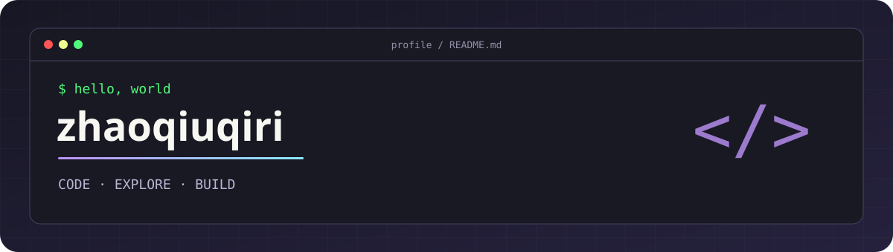

  

<h1 align="center">Hi 👋，我是 zhaoqiuqiri</h1>

欢迎来到我的 GitHub · 在代码中探索，把想法变成作品。

  
  

---

### 🧰 技术工具箱

  &nbsp;&nbsp;
  &nbsp;&nbsp;
  &nbsp;&nbsp;
  &nbsp;&nbsp;
  &nbsp;&nbsp;
  &nbsp;&nbsp;
  &nbsp;&nbsp;
  &nbsp;&nbsp;
  &nbsp;&nbsp;
  

  Python · FastAPI · JavaScript · TypeScript · Vue · Electron 
  MySQL · Docker · Linux · Git

---

### 📊 GitHub 动态

  

统计卡由第三方服务根据公开活动生成，可能存在缓存延迟。

---

<samp>Thanks for stopping by. Happy coding!</samp>

